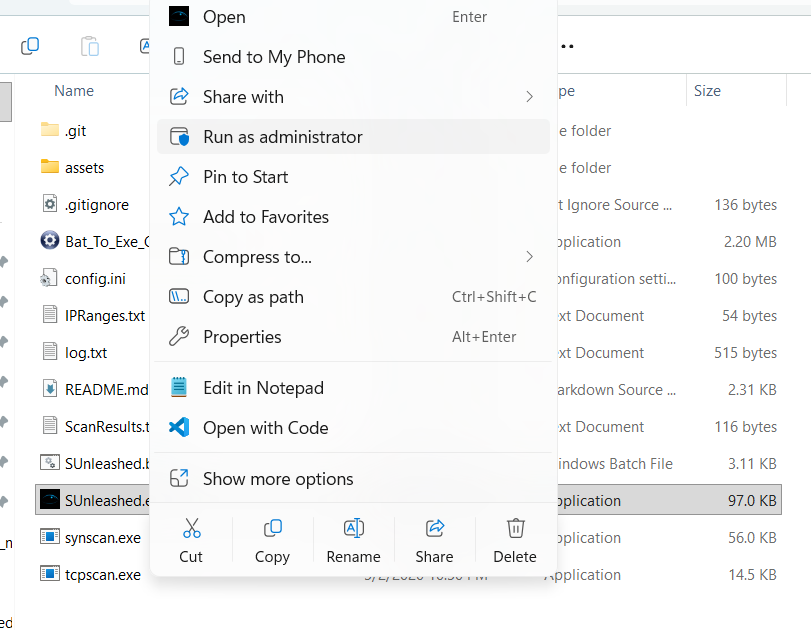
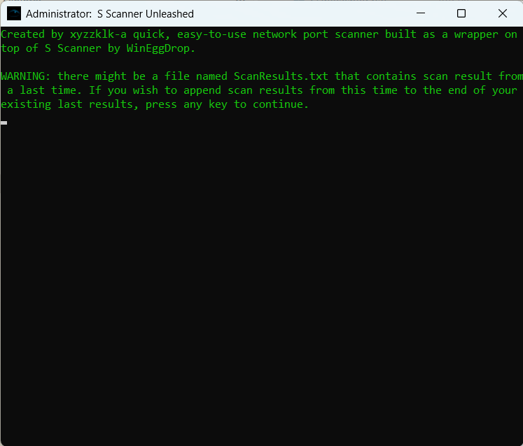
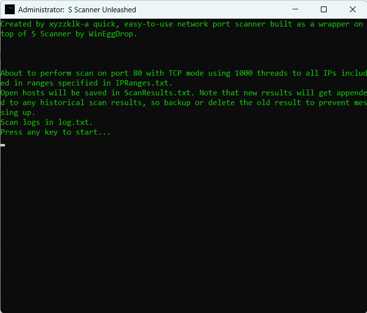
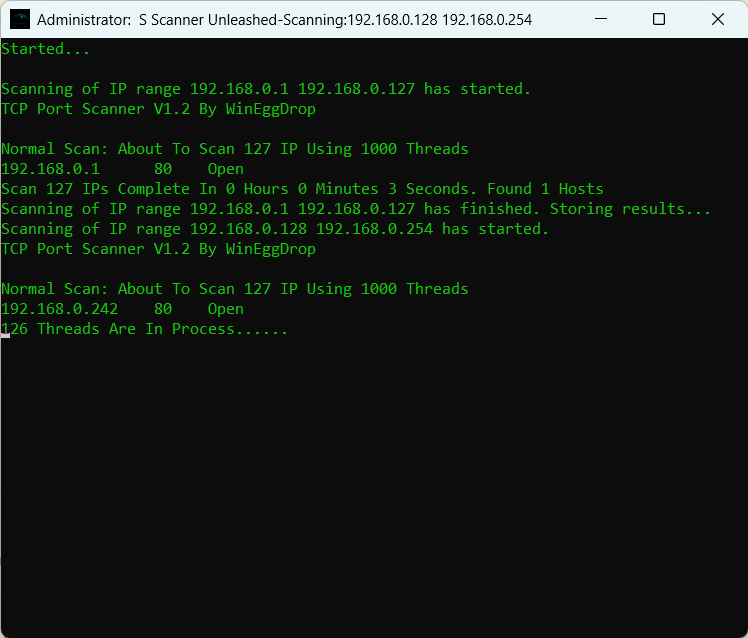
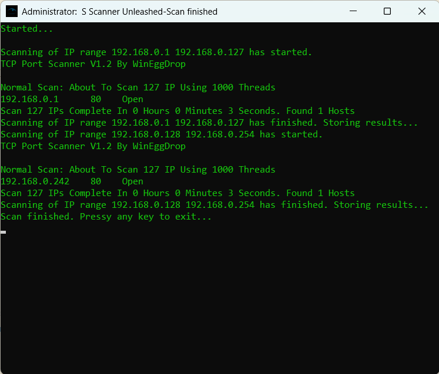
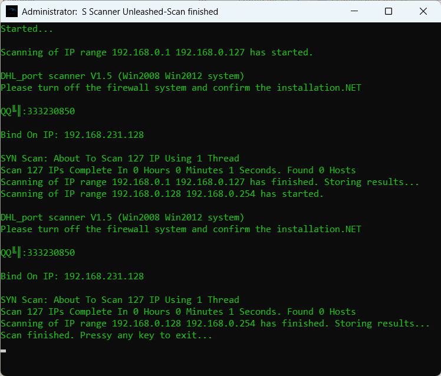

# Introduction
S Scanner Unleashed is a wrapper for S Scanner that reliably automates long-running bulk IP range network port scanning combined with logging and result formatting.

Compared to S Scanner alone, which can only handle one continuous IP range at a time, this wrapper enables bulk scanning for thousands of IP ranges, reliably and unmanaged.

The scan result is also formatted cleanly to a text file containing a list of up hosts, one line each, extracted from S Scanner's raw output.

> [!NOTE]
> Believe it or not, I originally wrote this sh*tty thing in middle school (Grade 8-9, 2019-2020). Now I'm just re-uploading whatever I wrote (and slightly modifying it as a backup).

> [!WARNING]
> This tool is designed for authorised network security testing, educational and research purposes. The author assumes no liability and is not responsible for any misuse or damage caused by this script.

# Usage
## Doanload
### Method 1: Cloning the repo
On a Windows machine, spin up a CMD shell and run the following commands to clone and enter the entire repository.
```bat
git clone https://github.com/xyzzklk/S-Scanner-Unleashed.git
cd SScannerUnleashed
```
### Method 2: Download a Pre-compiled Release
Alternatively, download a latest a pre-compiled release zip from [the release page](https://github.com/xyzzklk/S-Scanner-Unleashed/releases). Extract the zip file's contents to somewhere on your machine, and then use the following command to enter the folder.
```bat
cd "Drive Letter:\Path to folder\SScannerUnleashed\"
```

### Method 3: Compile from Scratch
This is optional, and could be done after performing Method 1. You could choose to compile the .bat file to an .exe file, though there will be no real difference from running a .bat script directly.

In this case, you could use the free open-source tool [Bat_To_Exe_Converter](https://bat-to-exe-converter-x64.en.softonic.com/download). Download and copy the binary into the repo folder, and execute a command similar to this to compile.
```bat
Bat_To_Exe_Converter_4.2 /bat SUnleashed.bat /exe SUnleashed.exe /icon assets/HYFrostEyeLogo.ico /fileversion "1.1.1.1" /productversion "1.1" /productname "S Scanner Unleashed" /originalfilename "SUnleashed.exe" /company xyzzklk /copyright "Copyright ©2026 xyzzklk. All rights reserved."
```

## Configuring the Scanner
To edit the config, simply modify `config.ini` located at the root path of the repo. The default configuration comes like this.
```ini
port=3389
mode=TCP
threads=1000
ipRanges=IPRanges.txt
cleanResults=ScanResults.txt
logs=log.txt
```
Which means that by default, the scanner scans port `3389` of every target IP address in TCP scan mode. The scan mode can also be switched to SYN to enable a stealthy SYN scan. In either mode, it uses `1000` threads by default.

Targets are stored as IP ranges in a file that you create and name as `IPRanges.txt` by default. IP ranges should be written in the following format, with start and end IP of a range separated by whitespace:
```kotlin
[start IP] [end IP]
[start IP] [end IP]
...
```

Like
```kotlin
1.1.1.1 1.1.1.255
1.1.2.16 1.1.2.38
```

Ranges do not have to start and end at complete subnets. The S Scanner binary will automatically calculate all IP addresses included in that start and end IP correctly.

If you want to scan a single target, simply set the start and end IP to be the same to indicate a range of one address:
```kotlin
1.1.1.1 1.1.1.1
```

By default, scan logs will be written to log.txt and up hosts detected will be written to ScanResults.txt. E.g.:
```kotlin
1.1.1.1
1.1.1.3
```
Which means these two hosts were detected to have port 3389 open in the last scan.

[!NOTE]
The following config tells S Scanner Unleashed to scan the IP ranges 192.168.0.1-192.168.0.127 and 192.168.0.128-192.168.0.254 with 1000 threads maximum in TCP mode to detect any hosts with HTTP port `80` open.
```ini
port=80
mode=TCP
threads=1000
ipRanges=IPRanges.txt
cleanResults=ScanResults.txt
logs=log.txt
```

Any output will be written to a newly created file called `ScanResults.txt`, with a newly created `log.txt` file for logs.

## Running
Simply use
```bat
call SUnleashed
```

If you want to be specific (if you have both bat and exe version), for example, use
```bat
call SUnleashed.exe
```

Or, in the simplest case, just double click on the executable.



Let's do a test run with the example config we had before. I've made sure that the target IP ranges are properly stored in the target file, specified by `ipRanges=`.
```bat
C:\Users\...>type IPRanges.txt
192.168.0.1 192.168.0.127
192.168.0.128 192.168.0.254
C:\Users\...>
```

Run the scanner. Here it warns us about the current config.


We press any key, say <kbd>Enter</kbd>, to continue and start the scan.



We press any key to quit the console window.

Check the results file specified by `cleanResults=`, we can see
```bat
C:\Users\...>type ScanResults.txt
192.168.0.1
192.168.0.242

C:\Users\...>
```

# Limitations
S Scanner doesn't seem to work properly with its SYN scan mode on Windows operating systems, so if SYN scan is requested, the binary executable `synscan.exe` will be called instead. It's a modified version of S Scanner from the "DHL" (Means "Big Grey Wolf", initials of "大灰狼") hacking group.

Even with the DHL version, SYN scan only works on Windows Server OSes, probably due to differences in low level system API calls and Windows limitations.

Thus, there is no need to be surprised if you see some error message like


with some configuration like
```ini
port=80
mode=SYN
threads=1000
ipRanges=IPRanges.txt
cleanResults=ScanResults.txt
logs=log.txt
```

# Credits
## Third Party Binaries Used
- S Scanner V1.2 by WinEggDrop
- S Scanner modified version ("V1.5") by "Big Grey Wolf" hacking group
- Bat_To_Exe_Converter V4.2 by Fatih Kotak